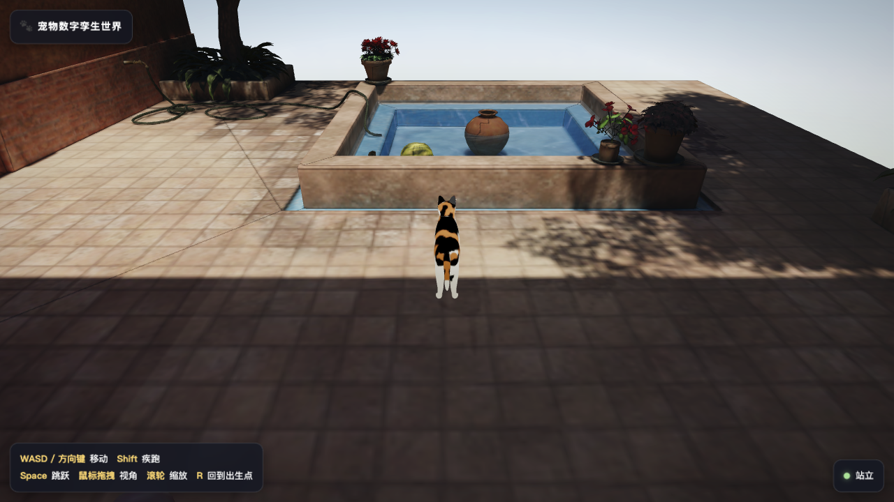
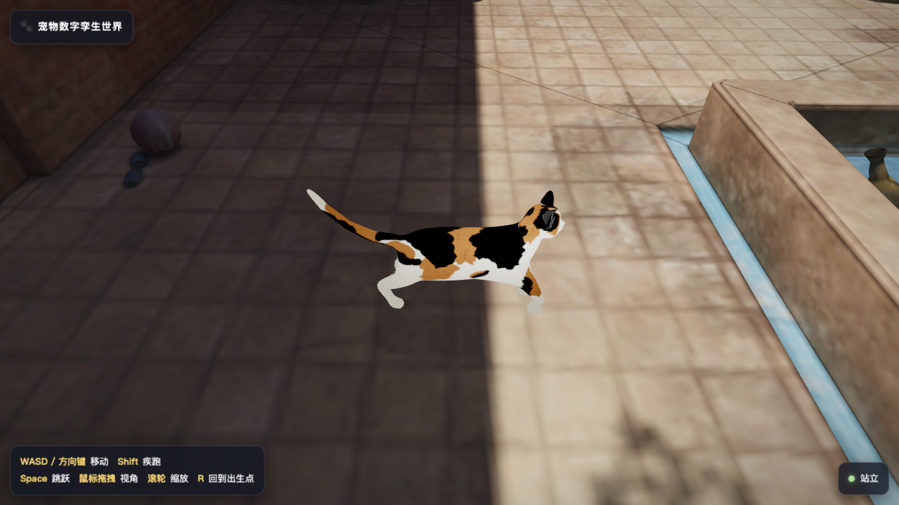
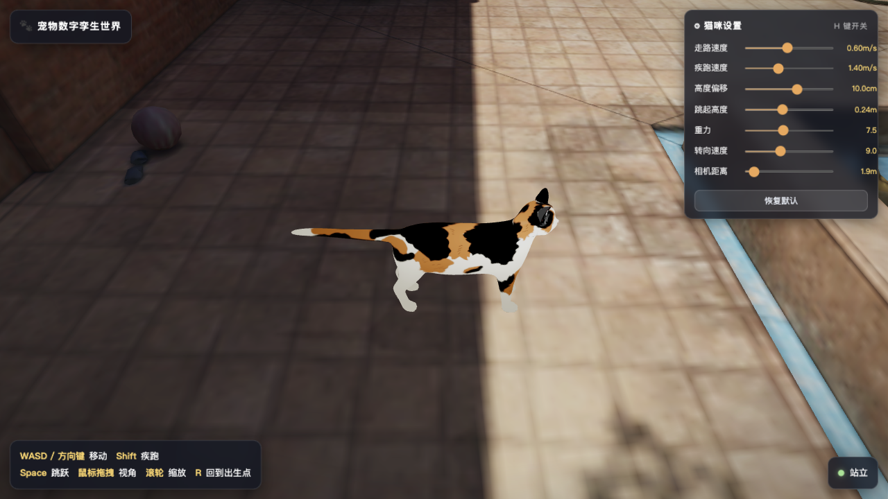
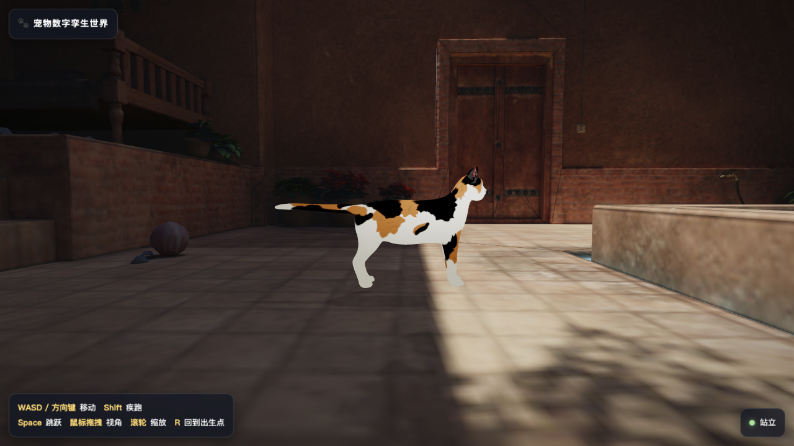
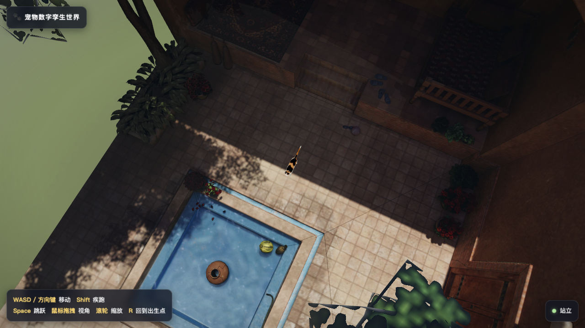

# 宠物数字孪生世界（Pet Digital Twin World）

一只三渲二三花猫在院子里自由漫步——Blender Rigify 步态动画 + Three.js 实时场景。

| | |
|---|---|
|  |  |
|  |  |

俯瞰整个院子：



## 运行

```bash
python3 -m http.server 8792
# 打开 http://localhost:8792
```

（ES Module + GLB 需要 http 服务，直接双击 index.html 不行。）

## 操作

| 按键 | 功能 |
| --- | --- |
| W A S D / 方向键 | 相机系移动 |
| Shift | 疾跑 |
| Space | 跳跃 |
| 鼠标左键拖拽 | 旋转视角 |
| 滚轮 | 缩放（1.5–9m） |
| H | 猫咪设置面板（localStorage 记忆） |
| R | 回到出生点 |

设置面板：走路速度 / 疾跑速度（m/s 绝对值）、高度偏移（修穿模）、跳起高度、重力、转向速度、相机距离。
静止时猫保持完全静止的站姿（无待机动画）。
走路速度 >0.45m/s 时自动切换奔跑动画（步频限制）。

## 素材与测量（来自 Blender 脚本实测）

- 场景：Sketchfab 导出，Maya 量纲按 **cm → ×0.01** 转米（院子约 18×19m）。
- 猫：`猫咪绑定_动画1.blend` 只选蒙皮网格 + 眼球（骨骼挂载）导出，cat 全长
  5.19 glTF 单位 → **×0.25 ≈ 1.30m**。朝向：Blender -Y → glTF +Z（标准朝前）。
- 步态（原地循环，root 每周期位移 ≈0，脚部 stance 位移即步幅）：
  - Walk 161f（5×32f）@24fps：步幅 ≈0.30–0.34u，**速度 0.3689 u/s**
  - Run 81f（5×16f）@24fps：步幅 ≈0.57–0.72u，**速度 3.4464 u/s**
- **爪部姿态**：支撑相滚转由 `foot_heel_ik / hand_heel_ik` 摇杆驱动（实测 1:1 传导）；
  控制骨只写位置，每帧实测爪骨世界俯仰并迭代补偿，支撑相平贴（漂移 <0.1°）。
- 消滑步原理：原地循环中 stance 期间脚掌相对 root 后移 stride，游戏里
  root 前进速度 = stride/stance时长 时脚掌世界静止。任意速度下
  `timeScale = speed/native` 依然精确无滑步。

## 三渲二材质

Blender 里猫的材质是 NPR 节点树（Diffuse → Shader to RGB → Color Ramp + 遮罩混色），
glTF 无法直接表达。管线：**烘好的 albedo 贴图（4096²，第 2 套 UV）+ 全材质
`KHR_materials_unlit` 平涂**——身体/眼睛/胡须按原版色值逐个平涂，
轮廓壳（Solidify 反转壳）不导出。

## 模型压缩

已做 **KHR_draco_mesh_compression**（加载时由 `DRACOLoader` 解码，`vendor/draco/`）：

| 模型 | 压缩前 | 压缩后 |
| --- | --- | --- |
| data/scene.glb | 12.1 MB | 6.6 MB |
| data/cat.glb | 4.5 MB | 3.2 MB |

压缩命令：`npx @gltf-transform/cli draco in.glb out.glb`。

## 代码结构（src/main.js）

- 加载：字节级进度条（scene 0.72 / cat 0.28 权重）+ Draco 解码
- 出生点：全场景向下射线 → 高度分桶面积投票（主步行面=铺装，避开池底/树冠）
  → 该层级离中心最近的开阔点（8 向 1.2m 净空检查）
- 控制器：朝向平滑转向（先转身再走）、重力跳跃、双高度墙面射线 + 贴墙滑移、
  地面射线贴地
- 相机：球坐标跟随 + 入墙回拉 + 贴地钳制（高墙顶部不算地面，改为拉近）
- 动画：Walk/Run 常驻 mixer 权重混合，`timeScale = speed/native` 消滑步
- 调试：`window.__game` 每帧状态快照；`window.__scrub = {time}` 冻结逐相检查；
  `window.__DBG = true` 开启输入日志；页面顶部红条显示未捕获异常

## 调参

全部在 `src/main.js` 顶部 `CFG`，面板滑杆实时生效并存 localStorage
（key `catgame-cfg-v2`）。
